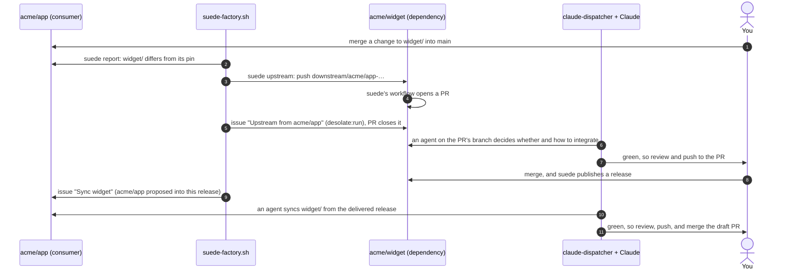
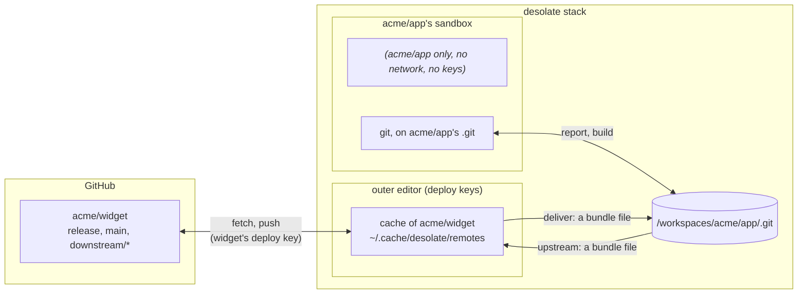
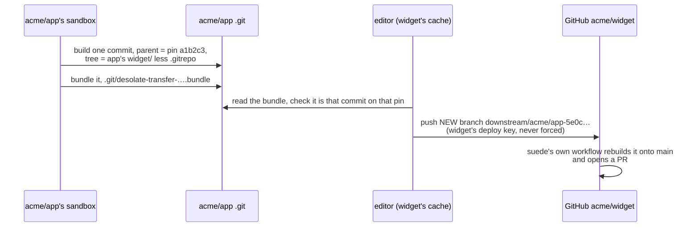

# The suede factory

When a project in the stack changes one of its [suede](https://github.com/pmalacho-mit/suede) dependencies, those changes are proposed back to the dependency automatically. An agent then decides whether and how to integrate them. When the dependency releases, every consumer in the stack is synced to the new release by an agent. Pushes and merges stay yours.

It is three parts, each doing one job:

| Part                                                     | Its job                                                                                                                                 |
| -------------------------------------------------------- | --------------------------------------------------------------------------------------------------------------------------------------- |
| **desolate**                                             | isolated environments, plus three narrow primitives for suede dependencies (below)                                                      |
| **`examples/factory/claude/claude-dispatcher.sh --all`** | starts a Claude agent, in a desolate worktree, for each issue labelled `desolate:run` in any project in the stack                       |
| **`examples/factory/suede/suede-factory.sh run`**        | connects them: proposes changes upstream, files the issues the agents work on, links and replaces PRs. It never starts an agent itself. |

Run the last two on your Mac. They talk only through GitHub issues: a label, plus a hidden marker in the body.

```bash
examples/factory/claude/claude-dispatcher.sh --all            # agents for every desolate:run issue (--max-agents 3)
examples/factory/suede/suede-factory.sh run --dry-run --once   # first: what it would do
examples/factory/suede/suede-factory.sh run                    # then: every 60 s
examples/factory/suede/suede-factory.sh status                 # what it is waiting on
examples/factory/suede/suede-factory.sh sync acme/app          # ask for syncs by hand (below)
```

## The loop, at a glance



## What counts as a suede dependency

A subrepo whose `.gitrepo` tracks `branch = release`. Two kinds of subrepo are excluded:

- the project's own `release/`;
- suede's tooling subrepos (`.suede/core`, the workflows), which track `dependency/...` branches.

**A nested dependency is its own.** A change under `outer/inner/` is proposed to `inner`'s repository, not to `outer`'s. It reaches `outer` later: `outer` syncs its vendored copy when `inner` releases, then releases itself, and then you sync `outer`.

**How a consumer uses a dependency** sets how pressing the work is:

| Kind          | When                                                                                          | What the agent is told                                                                                        |
| ------------- | --------------------------------------------------------------------------------------------- | ------------------------------------------------------------------------------------------------------------- |
| `release`     | the consumer is itself a suede dependency, and a root symlink `<name><sep><repo>` declares it | **Blocking:** the consumer cannot publish until this lands and it syncs. Integrate it, adapting where needed. |
| `vendored`    | it lives inside the consumer's `release/`                                                     | the consumer ships a fork as source; integrating it lets it drop the fork                                     |
| `development` | anything else, in a consumer that is a suede dependency                                       | useful to the consumer, and maybe to others; the agent decides, and "don't merge" is a fine answer            |
| `app`         | the consumer is not a suede dependency                                                        | the same as `development`                                                                                     |

## The flow

Each tick of `suede-factory.sh`:

1. **A consumer's `main` moved.** The factory:
   - refreshes `origin/*` (`cli.sh pull --fetch-only`);
   - reports its suede dependencies at `origin/<main>` (`cli.sh suede report`);
   - delivers the history of any it lacks (`cli.sh suede deliver`). A dependency that isn't in the stack is asked about once, by notification: `suede-factory.sh approve <owner/repo>` adds it, with `cli.sh repo add`, which clones it and creates a write deploy key on it. Until you approve, the consumer isn't looked at again; approving has every consumer of that dependency looked at on the next tick.
2. **A dependency differs from its pin.** `cli.sh suede upstream` pushes the change to the dependency as `downstream/<consumer>-<commit>`. That is suede's own branch, so suede's own workflow there opens the PR into `main`. The change is compared by `git patch-id`, and it isn't pushed when that exact change, from that consumer and folder:
   - **is already proposed:** its issue is open, or it was pushed and is waiting for its PR;
   - **was merged:** its issue closed as completed and its PR merged. The consumer's copy keeps differing until the release and the sync bring the change back, and that is not a new change;
   - **was closed without merging:** that was your answer. It is proposed again only once the change itself changes.
3. **That PR appeared**, opened since the push: an older PR on the same branch name belongs to an earlier proposal. The factory files an issue in the dependency, labelled `desolate:run` and `suede:upstream`, and edits the PR to `Closes #<issue>`. The issue holds:
   - the task, framed by kind;
   - the files, and the PR's own text;
   - every other open proposal into the dependency;
   - a marker telling the dispatcher to start the worktree on the PR's branch.

   The consumer keeps one open proposal per dependency folder. A newer change replaces the older one: the older PR and issue are closed, their branches kept, and the commits that had been added there are listed in the new issue for the agent to carry over.

4. **The agent works.** It runs in a worktree of the dependency, on the PR's branch. Other agents working on proposals into the same dependency are in the same repository, and coordinate through `/desolate/status board` and `note`. One can carry another's change; the one that hands its change over finishes `gray "withdrawn: …"`. When an agent finishes:
   - **green:** you're asked to review it and push it to the PR (the panel's Push, or `desolate --push --worktree <name> <project>`), then merge it;
   - **gray:** withdrawn; it's said on the issue and the PR.
5. **The dependency released**, i.e. its `release` branch moved, which happens after a merge publishes. Two kinds of consumer get a sync issue, `suede:sync`, release dependencies first:
   - **proposers:** consumers whose proposal was merged into this release. Their issue was closed as completed, and its PR is merged.
   - **blocked consumers:** those that ship the dependency as a release dependency while their copy still differs from its pin. They can't publish until they sync, even when their change was carried into someone else's PR.

   Nobody else is synced automatically; use `sync` for that, below. The release is delivered beforehand, and the issue spells out the offline sync:

   ```bash
   GIT_CONFIG_COUNT=1 GIT_CONFIG_KEY_0="url.$bundle.insteadOf" GIT_CONFIG_VALUE_0="$remote" bash <dir>/.suede/core/sync
   ```

   That runs suede's `sync` (`git subrepo pull`) against the delivered release, and `.gitrepo` keeps the real remote. On green you push, and the dispatcher opens a draft PR.

**What stays yours:** every push of an agent's work, every merge, and adding a dependency to the stack.

**What it does by itself:**

- it pushes `downstream/*` branches, whose content is already on a consumer's `main`, which you merged;
- it files and closes issues;
- it adds labels;
- it edits PR descriptions;
- it closes PRs a newer proposal replaces.

`--dry-run` does none of that. It says what it would do, and records nothing as done.

## Who syncs, and when

**On a release** (`run --sync <mode>`):

- **`proposers`, the default:** the consumers whose proposal was merged into it, plus those blocked on it, as in step 5. The work in flight stays easy to follow: only consumers already involved in this change get an agent.
- **`all`:** every consumer in the stack whose pin is behind.
- **`none`:** nothing on a release; only `sync` by hand.

**By hand, whenever you choose,** through the same issues, labels and agents:

```bash
examples/factory/suede/suede-factory.sh sync acme/app --dep acme/widget            # one consumer, one dependency
examples/factory/suede/suede-factory.sh sync acme/app                              # one consumer, all its dependencies
examples/factory/suede/suede-factory.sh sync acme/app acme/lib --dep acme/widget   # several consumers, one dependency
examples/factory/suede/suede-factory.sh sync acme/app acme/lib                     # several consumers, everything
examples/factory/suede/suede-factory.sh sync --all --dep acme/widget               # every project in the stack, one dependency
examples/factory/suede/suede-factory.sh sync --all                                 # every project, everything
```

`--dep` repeats. Each consumer named is looked at now, at its `origin/<main>`, and each of its suede dependencies (or only those `--dep` names) whose pin is behind its release gets a sync issue. An open sync for the same folder isn't filed twice. `--dry-run` says what it would file.

Every mode is bounded by the dispatcher's `--max-agents` (default 3): the rest wait their turn.

**Not built:** debounce, i.e. waiting N minutes after a release so several releases batch into one sync per consumer.

A dependency's first release seen is recorded, not acted on. Syncs follow the releases after that.

## desolate's part: `./cli.sh suede`

The factory asks desolate three things. You can ask them too: they're how you see what the factory sees.

| Command                                         | In one line                                                                                                                         |
| ----------------------------------------------- | ----------------------------------------------------------------------------------------------------------------------------------- |
| `./cli.sh suede report <project>`               | **Look:** which suede dependencies does this project have, and has it changed any? Changes nothing.                                 |
| `./cli.sh suede deliver <project> <owner/repo>` | **Bring in:** put a dependency's `release` history inside the project, so the look and the sync work with no network.               |
| `./cli.sh suede upstream <project> <folder>`    | **Propose:** turn the project's changes to that folder into a branch on the dependency's GitHub repository, where suede opens a PR. |

All three are on the Mac's `cli.sh` only. The editor's `desolate` and its panel don't offer them, and no devcontainer can reach them.

### The running example

`acme/widget` is a suede dependency. `acme/app` installed it into `widget/`, pinned at widget's release commit `a1b2c3`, and then changed `widget/lib.ts` and merged that to its `main`.

```text
/workspaces/acme/app/
├── .git/
├── src/...
└── widget/                ← acme/widget's release, as installed
    ├── .gitrepo           remote = …/acme/widget, branch = release, commit = a1b2c3…
    └── lib.ts             ← changed by acme/app
```

### Where each piece runs



The project's own git only ever runs in its sandbox, which sees that project alone. The editor, which holds the keys, only moves bundle files in and out of the project's `.git`, and pushes from its own cache.

### `report`: look

```bash
./cli.sh suede report acme/app --ref origin/main
```

In acme/app's sandbox, at `origin/main`:

1. find every subrepo tracking `release` (here `widget/`), skipping the project's own `release/` and suede's tooling;
2. classify how acme/app uses it (`app`, since acme/app isn't itself a suede dependency);
3. compare `widget/` with its pinned commit `a1b2c3`, leaving out `widget/.gitrepo` and any dependency nested inside.

It prints one line, `DEPS {…}`. Here it is, pretty-printed:

```json
{
  "commit": "5e0c…",
  "suede": false,
  "dependencies": [
    {
      "dir": "widget",
      "repo": "acme/widget",
      "pin": "a1b2c3…",
      "kind": "app",
      "state": "diff",
      "patch": "9f3c…",
      "files": [{ "status": "M", "path": "lib.ts" }]
    }
  ]
}
```

- **`state`** says what it found:
  - `same`: the folder matches its pin;
  - `diff`: acme/app changed it;
  - `nopin`: the pinned commit isn't in acme/app's history, so it needs a `deliver` first.
- **`patch`** is a fingerprint of the change (`git patch-id`). The same change has the same fingerprint, whatever commit carries it. That's how the factory knows not to propose it twice.

### `deliver`: bring in

```bash
./cli.sh suede deliver acme/app acme/widget
# suede: delivered acme/widget's release (a1b2c3d4e5f6) to acme/app
```

The editor refreshes its cache of acme/widget, using widget's own deploy key, so this works for private repositories too. It writes widget's `release` branch as one file, `/workspaces/acme/app/.git/desolate-dep-acme__widget.bundle`.

It's read by:

- **`report` and `upstream`,** for the pinned commit;
- **a sync agent in acme/app's devcontainer,** which pulls from it instead of the network:

```bash
# what a sync issue tells the agent to run
bundle="$(cd "$(git rev-parse --git-common-dir)" && pwd)/desolate-dep-acme__widget.bundle"
remote="$(git config -f widget/.gitrepo subrepo.remote)"
GIT_CONFIG_COUNT=1 GIT_CONFIG_KEY_0="url.$bundle.insteadOf" GIT_CONFIG_VALUE_0="$remote" bash widget/.suede/core/sync
```

The rewrite redirects the recorded remote to the bundle for that one command, and `widget/.gitrepo` keeps the real remote.

### `upstream`: propose

```bash
./cli.sh suede upstream acme/app widget --ref origin/main
# UPSTREAMED acme/widget downstream/acme/app-5e0c… 7d8e… 9f3c…
#            dependency  the branch it pushed     commit fingerprint
```



The branch name is exactly the one suede's own `upstream` script would push, so suede's workflow in acme/widget treats it the same: it replays the change onto the latest release, puts it under `release/` on top of `main`, and opens the PR. It refuses a branch that already exists, so the same proposal can't go twice. It only ever creates `downstream/*` branches, never touches `main` or `release`, and never force-pushes.

### Why these are narrow

- **The dependency is always named by the caller** (the factory, or you), never read from the project. A project can't redirect `deliver` to someone else's repository.
- **The scope is fixed:** only a `release` branch goes in, and only a new `downstream/*` branch goes out.
- **Devcontainers have no channel to any of this.**

"The Mac's alone" is a convention more than a wall: the editor already holds every key and cache, so a compromised editor could do these steps by hand. A real gate would mean moving keyring access out of the editor.

### What makes it work (measured)

- **The upstream push:** suede's workflow rebuilds a submission from `merge-base(release, submission)`, so one commit on the pin is all it needs, and no git-subrepo or network is needed in the sandbox. Suede's own `rebuild-pr-branch.sh` accepts it: the change lands under `release/`, `main`'s other files are kept, and there are no conflicts.
- **The offline sync:** `git -c url.<bundle>.insteadOf=<remote> subrepo pull` works with no network, and leaves `.gitrepo` alone. Don't use `subrepo pull -r <bundle>` for this: it writes the bundle's path into `.gitrepo`.

### Also added for the factory

- **`desolate --pull --fetch-only`:** refresh `origin/*` without moving anything checked out;
- **`/desolate/status note` and `board`:** how agents in one repository coordinate, explained in `AGENTS.md`;
- **git-subrepo 0.4.9:** claude-helper installs it for the session when a container lacks it.

## Not yet run for real

Everything above is tested with real git and git-subrepo, but against local remotes and stand-in `gh`/`cli.sh` (`tests/unit/desolate/deps.test.ts`, `tests/static/15-dispatcher.sh`, `tests/static/16-suede-factory.sh`). Not yet seen:

- suede's workflow opening the PR on GitHub, from a branch desolate pushed;
- an agent's sync in a real devcontainer;
- the whole loop on real repositories.

**To try it:**

1. Make two throwaway suede dependencies with suede's `scripts/create/dependency.sh`, e.g. `widget`, plus a consumer that installs `widget`.
2. `./cli.sh repo add` all three.
3. Change `widget`'s folder in the consumer, and merge to its `main`.
4. Run the factory with `--dry-run --once`, then for real, alongside `claude-dispatcher.sh --all`.
