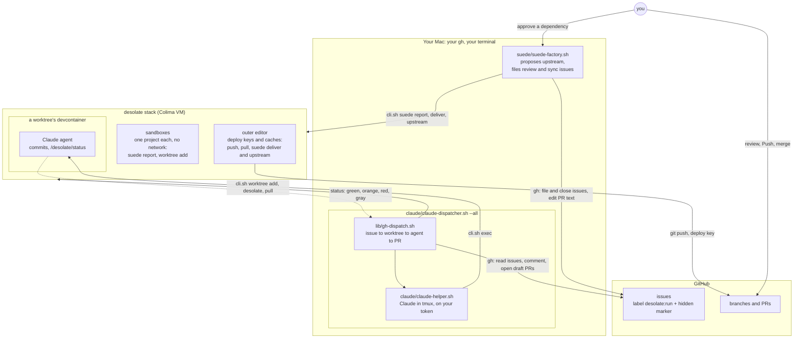
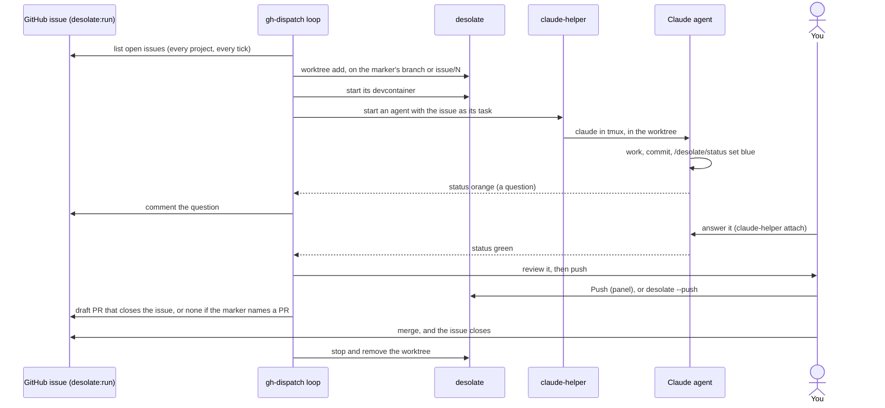

# examples/factory: software factories built on desolate

desolate itself only provides isolated development environments, plus a few primitives an outside script can drive (`docs/agents.md`). Everything in this folder is such a script: it runs on your Mac, uses your `gh`, and could be replaced by your own.

## Who does what

| Layer | What it does | What it never does |
| --- | --- | --- |
| **desolate** (the stack) | isolated devcontainers and worktrees; pushes and pulls with your deploy keys (`desolate --push/--pull`); the status each agent sets (`/desolate/status`); the three suede primitives (`./cli.sh suede`) | decide anything about issues, PRs or agents |
| **`lib/gh-dispatch.sh`** (the dispatch loop) | turns GitHub issues labelled `desolate:run` into worktrees with an agent in each; relays the agent's status (comments on orange/red, asks you to push on green, opens the draft PR); removes the worktree when the issue closes | write code, push, or merge |
| **`claude/claude-helper.sh`** (the agent driver) | Claude Code in a tmux session in a worktree, on your subscription token; installs tmux, claude and git-subrepo when missing; turns Claude's own events into statuses | choose what to work on |
| **the Claude agent** (inside the devcontainer) | reads the issue, works, commits, sets its status, coordinates through `board` and `note` | push, merge, or reach GitHub: it has no credentials |
| **`suede/suede-factory.sh`** (the suede connector) | watches the stack's projects for changes to suede dependencies, proposes them upstream, files the review and sync issues, links and replaces PRs | start agents (it files issues, the dispatcher starts the agents), push agent work, or merge |
| **you** | review, push (the panel's Push), merge; approve a new dependency joining the stack | |

The two scripts you run, `claude/claude-dispatcher.sh --all` and `suede/suede-factory.sh run`, never call each other. **GitHub issues are the contract between them**: the factory files an issue, and the dispatcher picks it up.

## How they connect



## The life of one issue

The same steps for any issue labelled `desolate:run`, whether you wrote it or the suede factory did:



## The contract: labels and markers

**`desolate:run`** on an issue means an agent should work on it. The dispatcher reads only that label.

An issue can also carry a **hidden marker** with details its number can't express. The suede factory writes these; the dispatcher reads them (`lib/gh-dispatch.sh`):

```html
<!-- desolate-dispatch: {"branch":"downstream/acme/app-5e0c…","start":"origin/downstream/acme/app-5e0c…","fetch":true,"pr":12} -->
```

| Field | Meaning | Without it |
| --- | --- | --- |
| `branch` | the worktree's branch | `issue/<n>` |
| `start` | where a new branch starts | the project's checked-out branch |
| `fetch` | refresh the project's `origin/*` first (`pull --fetch-only`) | no refresh |
| `pr` | the branch already has this PR: on green you're asked to push to it, and no new PR is opened | a draft PR is opened |
| `base` | the base of the PR it opens | the repository's default branch |

The suede factory keeps its own state in a second marker, `<!-- suede-factory: {...} -->`: which consumer and folder, the change's fingerprint, and the PR. That lets it restart from GitHub alone. The suede-specific labels, `suede:upstream` and `suede:sync`, are for your filtering; the dispatcher ignores them.

**Statuses** an agent sets with `/desolate/status`, as the dispatcher reads them:
- **blue:** working;
- **orange:** a question for you, commented on the issue;
- **red:** stuck;
- **green:** ready, so you're asked to push;
- **gray:** withdrawn: it recommends not merging, which is said on the issue and its PR.

## What's here

```text
examples/factory/
├── README.md                    this page
├── lib/gh-dispatch.sh           the dispatch loop (sourced by the dispatchers)
├── gh-dispatcher.sh             the loop, with any agent command (FACTORY_AGENT)
├── claude/
│   ├── claude-dispatcher.sh     the loop, with Claude via claude-helper
│   └── claude-helper.sh         Claude Code in a worktree: auth, start, resume, attach, verify
└── suede/
    └── suede-factory.sh         suede upstreaming and syncing (docs/suede-factory.md)
```

## Running it

```bash
# once: Claude's subscription token, stored in the VM, used only in the Authorization header
examples/factory/claude/claude-helper.sh auth <any project>

# any issue you label desolate:run, in any project in the stack
examples/factory/claude/claude-dispatcher.sh --all                  # --max-agents 3 by default

# plus, for suede dependencies
examples/factory/suede/suede-factory.sh run --dry-run --once        # first, see what it would do
examples/factory/suede/suede-factory.sh run
examples/factory/suede/suede-factory.sh sync acme/app               # ask for syncs by hand
```

More: `docs/agents.md` (desolate's primitives), `docs/suede-factory.md` (the suede side, with examples).
